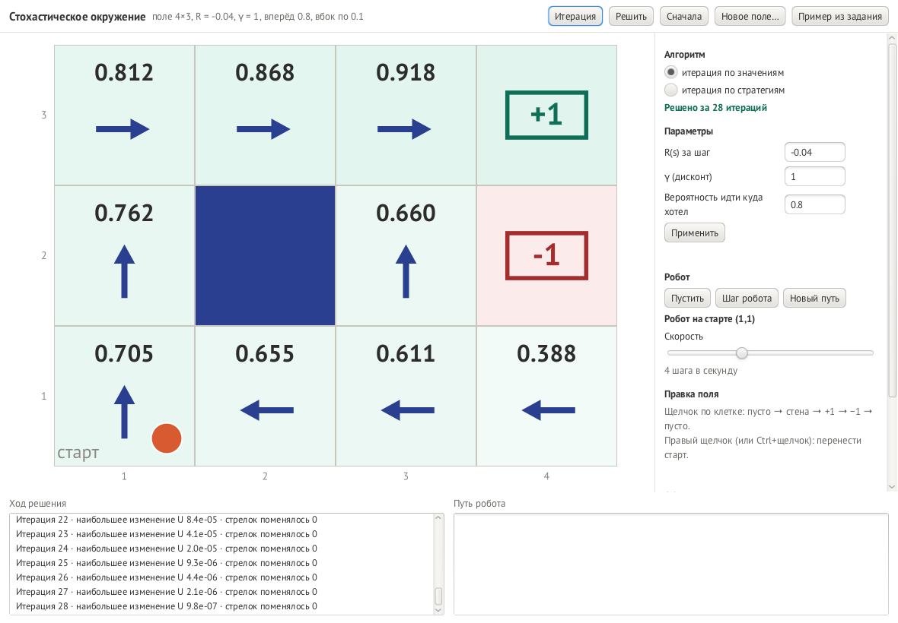
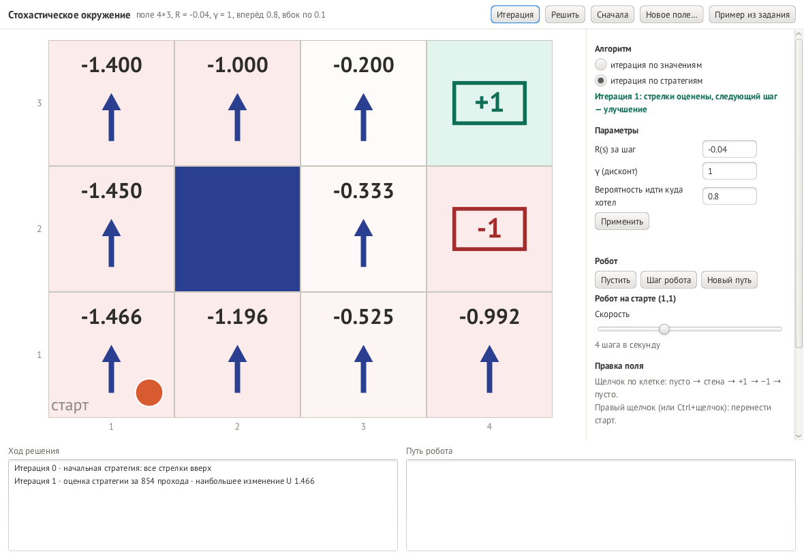
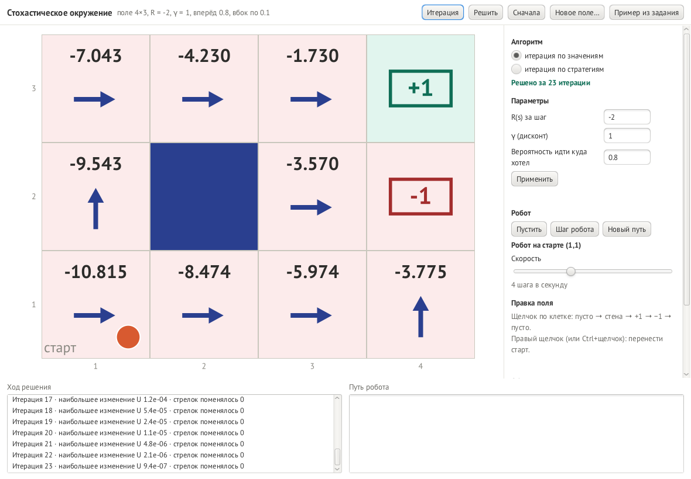
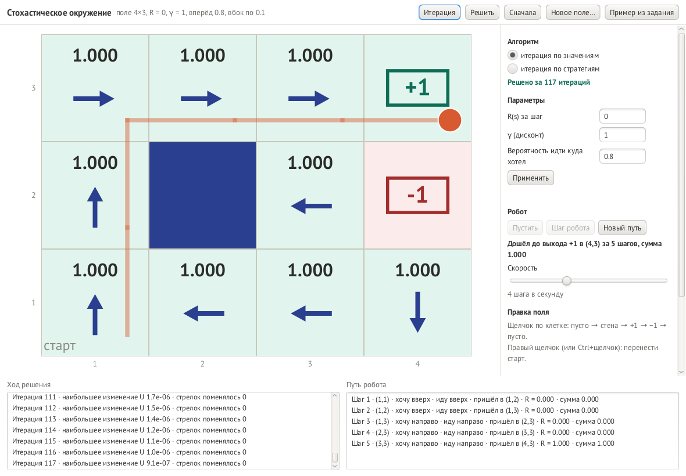
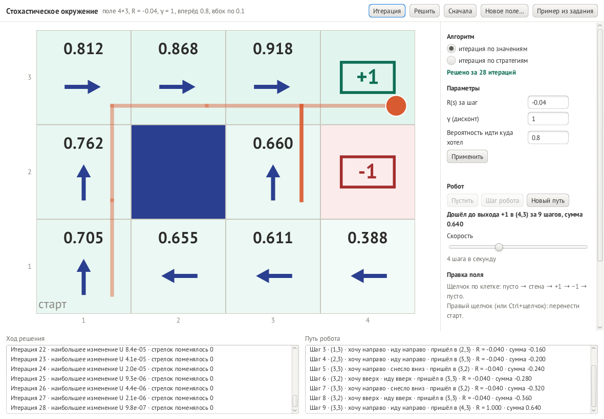
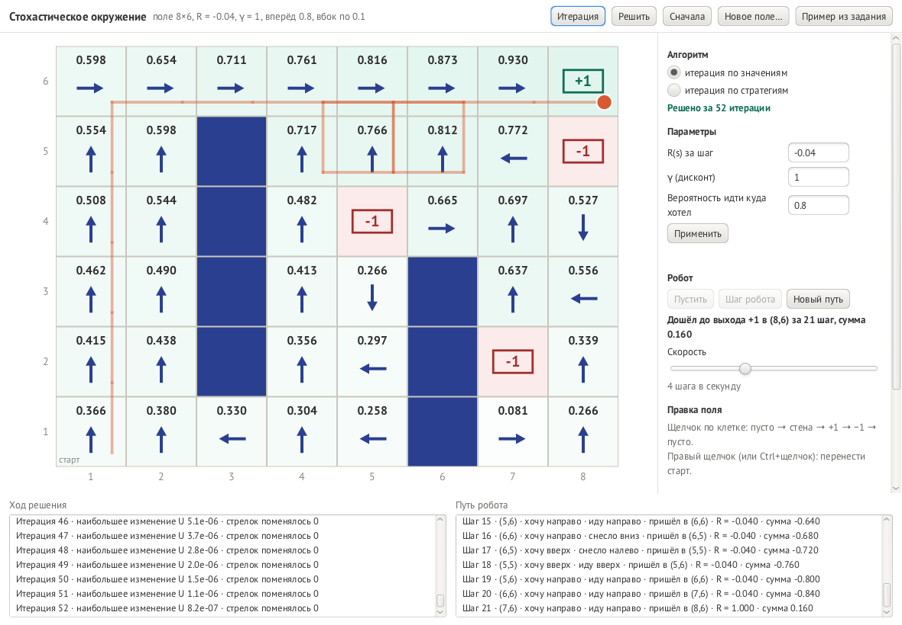
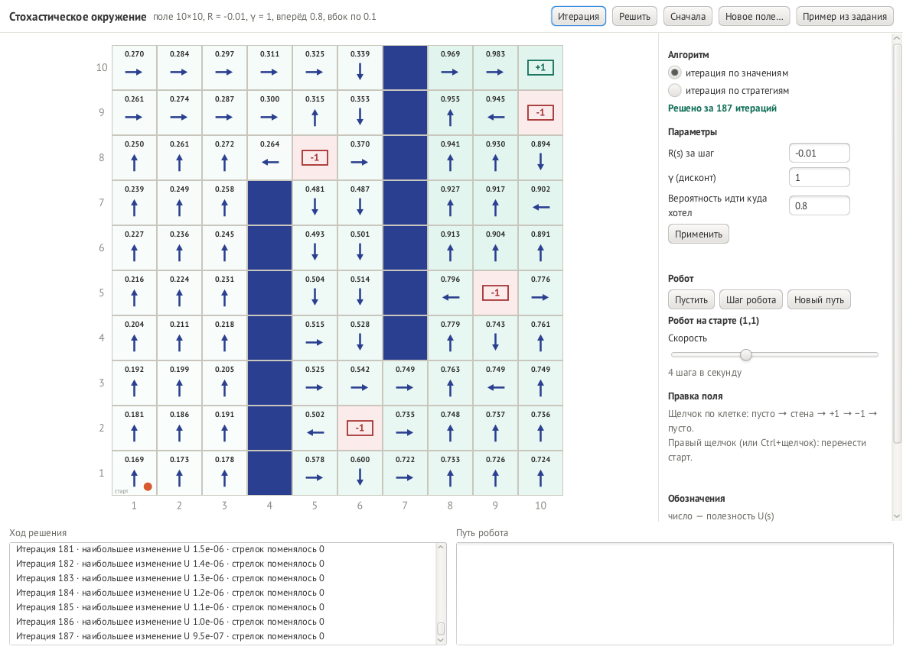
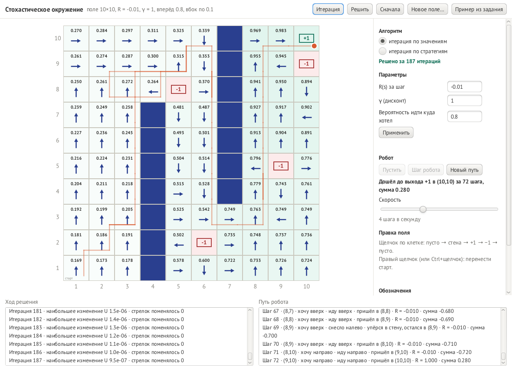

# Стохастическое окружение

Лабораторная работа № 5 по курсу «ООП на языке Java»: движение агента в стохастической среде
(марковский процесс принятия решений).

Робот ходит по полю 4×3. Он хочет дойти до клетки **+1** и не попасть в **−1**. Каждый шаг стоит
R(s) = −0.04. Ходы ненадёжны: робот идёт куда хотел с вероятностью 0.8, а с вероятностью 0.1 его
сносит влево и с 0.1 вправо. Если снесло в стену, он остаётся на месте. Программа находит **стратегию**
(стрелку в каждой клетке) и **полезность** U(s) каждой клетки (сколько робот в среднем наберёт,
если стартует отсюда) двумя алгоритмами из задания и получает ровно таблицу из задания.



## Требования

- JDK 25
- Maven 3.9+. Отдельно ставить не обязательно: Maven встроен в IntelliJ IDEA.

Библиотеки (JavaFX 25.0.4, JUnit 6.1.3) Maven скачивает сам при первой сборке.

## Запуск

### Из IntelliJ IDEA

1. Откройте папку проекта. Если IntelliJ не предложил **Load Maven Project**,
   нажмите правой кнопкой на `pom.xml` → **Add as Maven Project**.
2. Вверху справа, в списке запусков, выберите **Окно** и нажмите ▶.
   Настройка лежит в папке `.run/`; в ней уже прописан флаг `--enable-native-access=javafx.graphics`,
   без которого Java печатает предупреждения при старте JavaFX.

### Из терминала

```bash
mvn javafx:run
```

## Задача

| Что | Как |
|---|---|
| Поле | W×H клеток, от 2 до 10 по каждой стороне. Клетка — (столбец, строка), (1,1) — левый нижний угол, как в задании |
| Пример из задания | 4×3, стена (2,2), +1 в (4,3), −1 в (4,2), старт (1,1) |
| Выходы | +1 и −1: попал — путь окончен, получил награду |
| R(s) | плата за шаг в обычной клетке, по умолчанию −0.04 |
| Ветер | вперёд с вероятностью p = 0.8, вбок влево и вправо по (1 − p)/2 = 0.1; назад не сносит никогда |
| γ | коэффициент дисконтирования: награда через k шагов весит γᵏ; по умолчанию 1 |

## Как считается

Полезность клетки — награда здесь плюс среднее по исходам лучшего хода (уравнение Беллмана):

```
U(s) = R(s) + γ · max по ходам a  Σ T(s, a, s') · U(s')
```

Пример для (3,3), ход вправо: 0.8 · U(+1) + 0.1 · U(3,3) (вверх — стена, остался) + 0.1 · U(3,2) =
0.8 · 1 + 0.1 · 0.918 + 0.1 · 0.660 = 0.958; минус 0.04 — получается 0.918, как в задании.

**Итерация по значениям.** Сначала везде 0, в выходах их награда. Каждая итерация пересчитывает
U(s) всех клеток по формуле, беря числа соседей с прошлой итерации; стрелка — ход с наибольшим средним.
Конец, когда числа меняются меньше чем на 0.000001: на примере из задания это 28 итераций.

**Итерация по стратегиям.** Начальная стратегия — все стрелки вверх. Затем чередуются два шага:
**оценка** — U(s) для текущих стрелок (та же формула, но ход берётся из стрелки, а не лучший; проходы
повторяются, пока числа не устоятся) и **улучшение** — в каждой клетке стрелка разворачивается
на лучший ход по этим числам. Конец, когда ни одна стрелка не поменялась: 5 итераций.

Оба алгоритма дают одинаковые числа и стрелки, как в задании:

| | 1 | 2 | 3 | 4 |
|---|---|---|---|---|
| **3** | 0.812 → | 0.868 → | 0.918 → | +1 |
| **2** | 0.762 ↑ | стена | 0.660 ↑ | −1 |
| **1** | 0.705 ↑ | 0.655 ← | 0.611 ← | 0.388 ← |

Из (3,1) робот идёт налево, в обход, а не вверх мимо −1: обход длиннее, но снос там не опасен.

## Как R(s) меняет стратегию

| R(s) | Что делает робот |
|---|---|
| −2 | шаг дороже любого приза: из (3,2) сразу в −1, лишь бы закончить |
| −0.4 | идёт кратчайшим путём, рискуя рядом с −1 |
| −0.04 | как в задании: обходит −1 верхом |
| −0.01, 0 | не рискует совсем: в (3,2) и (4,1) упирается в стену и ждёт, пока ветер снесёт в безопасную сторону — назад, в −1, ветер не сносит |
| > 0 | гулять выгоднее, чем выходить; при γ = 1 сумма бесконечна и решение не сходится, при γ = 0.9 сходится |

## Робот

Робот идёт по стрелкам, ветер сносит его случайно. В журнале каждая строка — шаг: где был, куда хотел,
куда снесло, куда пришёл, R(s) и сумма Σ γᵗ · R(sₜ). Каждый запуск программы — свой случайный путь,
«Новый путь» берёт следующий. В среднем по 2000 путей робот набирает 0.706 — это U(1,1) = 0.705.

## Управление

| Элемент | Что делает |
|---|---|
| **Итерация** | Одна итерация алгоритма. Для итерации по стратегиям — по очереди оценка и улучшение. |
| **Решить** | Итерации до конца. |
| **Сначала** | Решение с итерации 0. |
| **Новое поле…** | Пустое поле W×H: +1 в правом верхнем углу, −1 под ним, старт (1,1). |
| **Пример из задания** | Поле 4×3 и параметры из задания. |
| **Алгоритм** | По значениям или по стратегиям. |
| **Параметры** | R(s), γ, вероятность идти куда хотел; **Применить** начинает решение заново. |
| **Пустить / Шаг робота / Новый путь** | Робот идёт сам, делает один шаг, начинает новый случайный путь. |
| **Скорость** | От 1 до 50 шагов робота в секунду. |
| **Щелчок по клетке** | Пусто → стена → +1 → −1 → пусто. **Правый щелчок** (или Ctrl+щелчок) — перенести старт. |

В клетке — U(s) и стрелка стратегии, оттенок зеленее к +1 и краснее к −1. Внизу два журнала:
ход решения (на итерацию: наибольшее изменение U, сколько стрелок поменялось) и путь робота.

## Защита от неверного ввода

В полях параметров и в окне «Новое поле» программа не падает и объясняет ошибку: пусто, буквы, `1e3`,
`NaN`, цифры других алфавитов (`٣`, `５`), слишком большие числа, управляющие символы. Дробь можно
писать через точку или запятую, минус — `-` или `−`. Проверяется и смысл: R(s) от −10 до 10,
γ больше 0 и не больше 1, вероятность от 0 до 1, размер поля от 2 до 10. Неверные поля подсвечиваются.
Если поле нельзя решить (например, при γ = 1 из части клеток не дойти до выхода), программа
останавливается через 10 000 итераций и пишет «Не сошлось», а робот — через 1000 шагов.

## Структура

```
src/main/java/mdp/
├── Launcher.java             точка входа
├── model/                    задача
│   ├── Cell, Move            клетки и ходы
│   ├── CellKind, GridWorld   поле: стены, выходы, старт; пример из задания; правка
│   ├── Settings, GridSize    параметры R(s), γ, p и размер + проверка
│   └── Mdp, Outcome          исходы хода: вперёд p, вбок (1 − p)/2, в стену — на месте
├── solver/                   алгоритмы
│   ├── Solver, Algorithm     пошаговое решение, выбор алгоритма
│   ├── ValueIteration        итерация по значениям
│   ├── PolicyIteration       итерация по стратегиям: оценка и улучшение
│   ├── Bellman, Evaluation   оценка стратегии, среднее по исходам, лучший ход
│   └── Snapshot, Phase, Utilities, Policy   состояние после итерации
├── robot/                    агент Robot (decide, move, utility), RobotStep: путь со случайным сносом
├── controller/               логика окна без JavaFX: AppController, формы, Texts, SpeedScale
├── view/                     окно JavaFX: MdpApp, GridCanvas, FormDialog
└── util/SafeText             безопасный показ ввода в сообщениях
```

## Документы

- [Отчёт (Word)](docs/report/Отчет_ЛР5_Минязов.docx) и [PDF](docs/report/Отчет_ЛР5_Минязов.pdf); собирается скриптом `docs/report/build_report.js`
- [Презентация](docs/presentation/Презентация_ЛР5_Минязов.pptx); собирается скриптом `docs/presentation/build_presentation.js`
- UML-диаграммы (PlantUML): `docs/uml`

## Тесты

```bash
mvn test
```

151 тест на JUnit 6, запускаются в случайном порядке. Главные проверки: оба алгоритма дают таблицу
и стрелки из задания; неподвижная точка удовлетворяет уравнению для (1,1) из задания; на 150 случайных
полях алгоритмы совпадают; режимы R(s) = −2, −0.01 и R > 0 дают известные стратегии; средний путь робота
по 4000 запускам равен U(1,1); методы агента decide, move и utility проверены по отдельности; бесконечные случаи останавливаются по лимиту. Логика кнопок, таймера
и форм проверяется без открытия окна. Тесты проверены мутациями: в код вносилась ошибка, тесты должны были её найти.

## Снимки

| Итерация по стратегиям: оценка | Улучшение |
|---|---|
|  |  |

| R(s) = −2: сразу в −1 | R(s) = 0: без риска |
|---|---|
|  |  |

| Путь робота со сносом | Своё поле 8×6 |
|---|---|
|  |  |

| Лабиринт 10×10 (R = −0.01): решение | Путь робота по лабиринту |
|---|---|
|  |  |

Лабиринт: стены в столбце 4 (строки 1–7) и в столбце 7 (строки 4–10), ловушки −1 в (5,8), (6,2), (9,5).
При R = −0.04 путь длиной около 60 шагов стоит дороже выигрыша, поэтому плата уменьшена до −0.01:
187 итераций по значениям, 10 по стратегиям, робот проигрывает примерно в 10 % путей.
